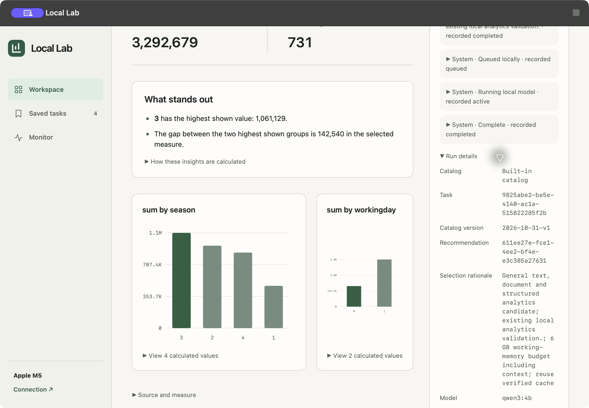
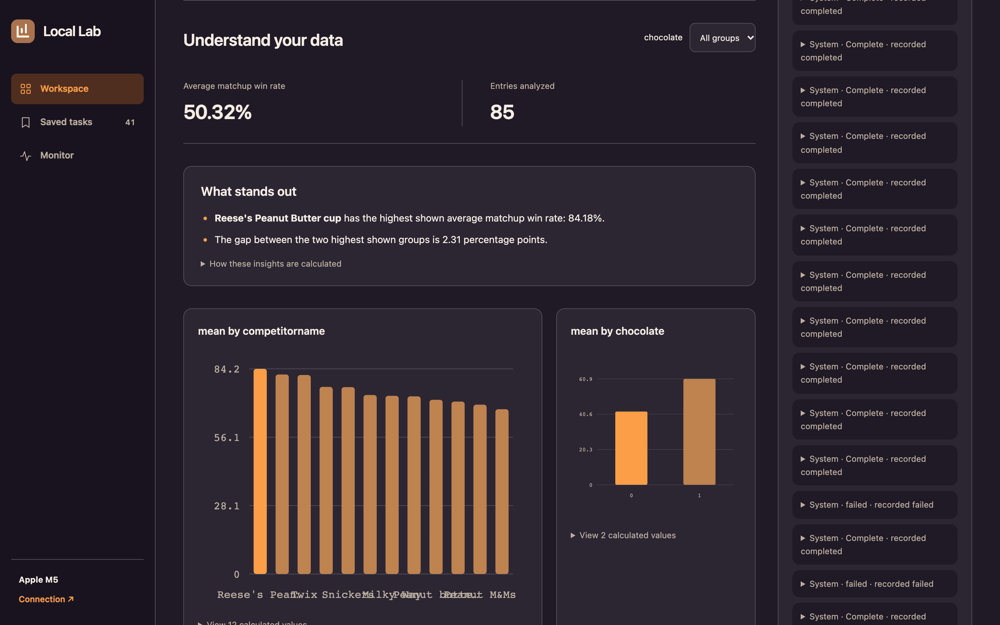
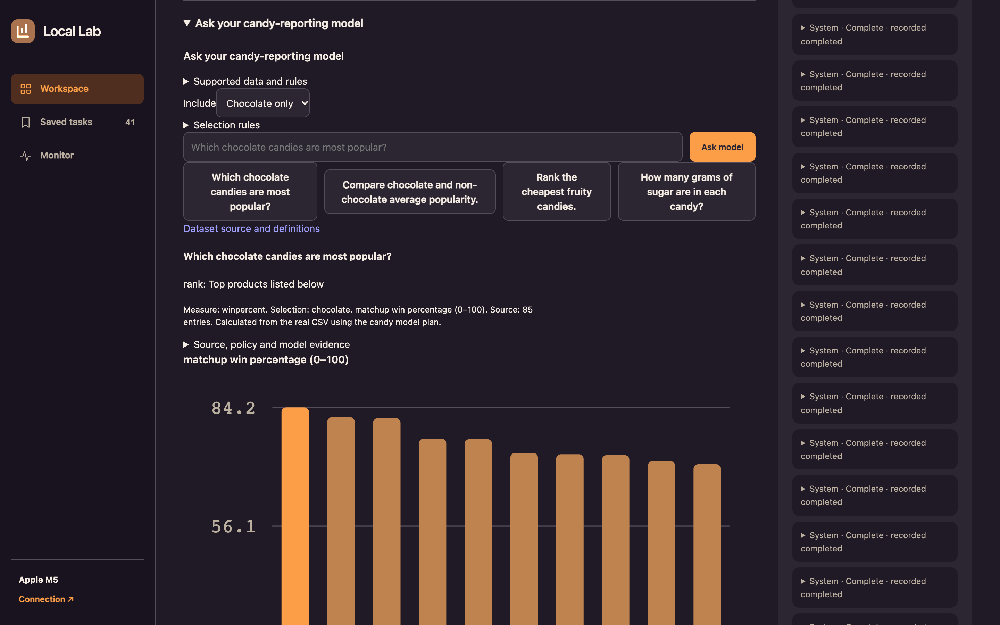
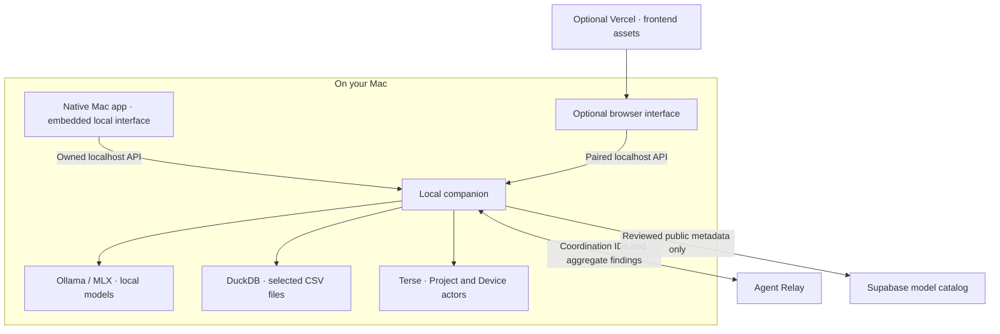

# Local Lab

### Local AI for everyday business questions.

Describe what you need, review a model that fits your Mac, and turn a CSV into a useful dashboard. Local Lab brings model setup, analysis and task-specific adaptation into one workflow, while keeping your files and model weights on your computer.

Originally built for **Haunted Hacks 2026**, now under continued development.

**No cloud account required.** Local Lab v0.7.0.0 runs its models, CSV calculations, durable queue and saved tasks on your Mac. Internet is needed to install runtimes and download models; supported tasks then work offline. Relay and the shared model catalog are optional integrations.

[Download for Apple Silicon Mac](https://github.com/bn-19/local-ai-lab/releases/download/v0.7.0.0/Local-Lab-Mac-App.zip) · [Get started](#try-the-csv-demo-on-your-mac) · [Local-first details](docs/LOCAL_FIRST.md) · [Architecture](#architecture)

## Try the CSV demo on your Mac

You need an **Apple Silicon Mac (M1 or later), macOS 14+**, enough memory/disk for your selected model, and an internet connection for initial setup. The demonstrated machine is an M5 MacBook Pro with 32 GB memory. Git, Homebrew and administrator privileges are not required to use the packaged app.

**[Download Local Lab · v0.7.0.0](https://github.com/bn-19/local-ai-lab/releases/download/v0.7.0.0/Local-Lab-Mac-App.zip)** · [Release notes and checksums](https://github.com/bn-19/local-ai-lab/releases/tag/v0.7.0.0)

### 1. Install, start and connect

1. Extract **Local-Lab-Mac-App.zip** and move **Local Lab.app** to Applications. It is **ad-hoc signed and not notarized**. macOS may block a downloaded copy; review its source/origin and use macOS's per-app Open/Open Anyway flow. Do not disable system security.
2. Open **Local Lab.app**. On a fresh installation, choose **Install Runtime**. If you already use an older runtime, choose **Update Local Runtime** to install the bundled source while preserving saved tasks, private files and model weights. No account or Relay workspace is needed.
3. The app starts and pairs its embedded local workspace automatically. No Terminal window or Vercel page is needed. Model weights remain a separate approved download, with requirements shown before installation.

Source updates require the runtime to be stopped and compatible dependency/runtime versions. Previous source is retained for recovery; it is not a second copy of your private data. [Native setup, update and distribution limitations →](macos/README.md)

### 2. Upload any supported CSV

1. Choose your CSV under **Your data** and describe the analysis you want. Confirm the measure, value/group columns and optional date/filter columns from its actual schema.
2. Select **Review setup**. Review a compatible model, approve its download if needed, wait for **Ready**, then select **Run task**.
3. Inspect the calculated dashboard, filter it, ask a follow-up or reopen it from **Saved tasks**. Activity records the selected model, local queue and measured work.
4. Choose **Quit Local Lab** to stop owned services. Saved work and model weights remain on your Mac.

For a reproducible non-candy example, download the public [UCI Bike Sharing dataset](https://archive.ics.uci.edu/dataset/275/bike+sharing+dataset) and use **day.csv** (CC BY 4.0). Ask “Show total bike rentals by season with a working-day filter.” Choose **sum**, value **cnt**, group **season**, filter **workingday**, and no date column. Expect **731 rows / 3,292,679 rentals**; filter `workingday = 1` gives **500 rows / 2,292,410 rentals**. These totals were independently checked with the real model and external networking denied.



Normal CSVs share the same workflow. Legacy candy/retail adapter experiments require explicit experimental opt-in and do not establish general-purpose fine-tuning support. [Measured account-free operation, persistence and recovery →](docs/LOCAL_FIRST.md)

**Troubleshooting:** Wait for setup or the source update to finish. If a port or runtime lock is occupied, stop the other Local Lab session normally. Private diagnostics are in `~/Library/Application Support/Local Lab/Host Logs` and may contain credentials; do not publish them. [Recovery and setup details →](macos/README.md)

### Optional example: historical candy-preference data


1. **[Download the original candy-data.csv](https://raw.githubusercontent.com/fivethirtyeight/data/4b9d687691091f8e44addfb051a651aebc1a4862/candy-power-ranking/candy-data.csv)** from FiveThirtyEight. If it opens as text, save it as `candy-data.csv`, not an HTML page. This pinned file has **85 entries** and is licensed CC BY 4.0.
2. In **Workspace**, choose that file under **Your data**. In **What do you need?**, enter:

   > Compare candy popularity using matchup win rates. Rank the candies and let me filter chocolate versus non-chocolate entries.

3. Confirm these fields after the CSV imports:

   | Field | Select |
   | --- | --- |
   | Measure | **Average of a column** |
   | Value | `winpercent` |
   | Compare groups by | `competitorname` |
   | Options → Filter dashboard by | `chocolate` |
   | Options → Date column | **No date column** |

4. Click **Review setup**. Review the recommended model and its requirements. If it is missing, click **Download** and wait until it is **Ready**, then click **Run task**. For reference, the reviewed Qwen3 4B download is about 2.5 GB; your actual recommendation is shown in the app.
5. Inspect the generated charts, statistics and **Activity** panel. With all groups included, expect **85 entries** and an **average matchup win rate of 50.32%**. Set the `chocolate` filter to `1`: expect **37 entries** and **60.92%**. Set it to `0`: expect **48 entries** and **42.14%**. These are historical preference scores, not sales figures.
6. Open **Saved tasks** and reopen the result to check persistence. You can also toggle **Halloween mode**. When finished, choose **Quit Local Lab**; its owned local services stop and saved work and models remain on your Mac.

This walkthrough runs a real local model and calculates results from the uploaded CSV. **Open sample** is a separate fictional preview and does not run a model. Fine-tuning is optional, requires the separate [MLX setup](docs/WEIGHT_FINETUNING.md), and is not needed for this dashboard.




*Actual production capture. The hosted interface connects to a paired local companion; running an analysis requires that companion on your Mac.*

## The experience

1. **Describe your question.** Attach a CSV and explain the analysis you want.
2. **Review the setup.** Check the recommended model, runtime, download size and memory requirements.
3. **Build a dashboard locally.** A local model proposes a bounded analysis plan. DuckDB calculates the values behind the charts, summaries and filters.
4. **Ask a follow-up.** Use the local reporting model for supported rankings, comparisons and aggregations. Confirm ambiguous selections in the interface.
5. **Keep your work.** Saved tasks retain the selected setup, results and recorded Activity. Reopen an analysis without starting over.

Model selection uses explicit compatibility rules over a reviewed catalog. It is not a claim to have benchmarked every available model or found a universal “best” model.

## Historical hackathon demo

> “Which chocolate candies are most popular?”

The main demonstration analyzes FiveThirtyEight's public candy-preference CSV. Rankings, category comparisons and summary statistics come from the actual data. Filters change the underlying calculation. The Halloween switch changes the theme while preserving the same analysis tools.

| A result you can check | Value |
| --- | ---: |
| Dataset entries | 85 |
| Average matchup win rate, all entries | 50.32% |
| Average matchup win rate, chocolate entries | 60.92% |
| Average matchup win rate, non-chocolate entries | 42.14% |

These are historical head-to-head preference scores, not sales, current demand or nutrition measurements. The original dataset includes coin comparison entries. Category differences are descriptive, not causal.



*The model interprets the question; trusted operations calculate the answer. The confirmed Chocolate/Fruity/All selection stays visible.*

### Experimental adaptation with evidence

Local Lab can evaluate a reviewed reporting recipe and attempt bounded MLX QLoRA training when development checks justify it. A candidate is selected only when it improves the measured comparison; ties retain the current setup.

One measured candy-adapter experiment improved **26/33 → 29/33** on authored, held-out instruction-mapping checks. Training and evaluation took **115.767 seconds** on an Apple M5 MacBook Pro with 32 GB memory. The baseline was an existing adapter, not the untuned foundation model. These small synthetic checks do not establish general analytics accuracy.

**The reporting adapter and dashboard planner are separate.** Fine-tuning supports the reporting workflow; it is not presented as the source of the dashboard's arithmetic. [Experiment and transport evidence →](docs/AGENT_LOOP_AND_STORAGE.md)

## Why the infrastructure matters

| Component | Its job in Local Lab |
| --- | --- |
| **Terse Durable Actors** | Persist tasks, job attempts, selected configurations and results. A Device actor owns the queue so heavy local jobs run one at a time. |
| **Agent Relay (optional)** | Explicitly enabled coordination integration. Default startup and tasks use the local durable queue without a cloud account or connection. |
| **Supabase** | Share a read-only catalog of reviewed model identities and versions. Private files, task contents and weights are not stored in that catalog. |
| **Ollama / MLX** | Run supported models locally; MLX provides the separate Apple Silicon reporting-adapter training path. |
| **DuckDB** | Import the CSV and execute validated calculation templates. The app does not execute model-written SQL, Python or shell. |
| **Native Mac app / optional Vercel UI** | The Mac app embeds its locally served interface and manages its owned services. The optional hosted UI connects directly to a paired local companion; CSVs do not pass through a Vercel API. |

Activity exposes recorded work and supporting evidence. A completed pipeline step is not automatically treated as a successful model evaluation.

## Architecture



Raw inputs, outputs, adapters and credentials stay in ignored local storage. Relay receives coordination metadata rather than CSV rows or raw answers. The optional shared catalog falls back to reviewed built-in metadata when unavailable. A project directory or virtual environment is not an operating-system sandbox.

## Quick start

**For developers installing from source.** Judges can use the [Mac app walkthrough above](#try-the-csv-demo-on-your-mac) instead of these commands.

The supported runtime is **Apple Silicon macOS** with **Node.js 22+** and enough memory and disk for the selected model. The demonstrated machine is an M5 MacBook Pro with 32 GB unified memory. Model downloads and initial runtime setup require a network connection.

### 1. Install the project

```sh
git clone https://github.com/bn-19/local-ai-lab.git
cd local-ai-lab
npm ci
npm --prefix web ci --ignore-scripts
npm --prefix web run build
```

### 2. Prepare the local services

The runner expects the official Ollama executable at `.local-lab/runtime/ollama`. If the Ollama CLI is installed and available on your `PATH`, a fresh checkout can reference it with:

```sh
mkdir -p .local-lab/runtime
ln -s "$(command -v ollama)" .local-lab/runtime/ollama
```

For optional cloud coordination, explicitly opt in to Agent Relay; default startup and tasks run locally without it. `npm run setup:relay` provisions a workspace only when you choose that integration. [Installation, identity setup and recovery →](docs/IMPLEMENTATION.md)

Start each service in a separate terminal:

```sh
npm run runtime:actors
```

```sh
npm run runtime:ollama
```

```sh
npm run dev
```

### 3. Connect and analyze

Open the [hosted app](https://local-lab-bn-19s-projects.vercel.app) or [local interface](http://127.0.0.1:4173/app/). Read `.local-lab/pairing-token` locally and enter it in **Connect your Mac**. The token is held in the browser tab's memory; do not put it in a URL or commit it. Your browser may request permission to access the local service.

Attach a CSV, describe the question, review the model recommendation and approve any required download. Adapter training is optional and needs the separate [MLX setup and reviewed recipe](docs/WEIGHT_FINETUNING.md). A clean checkout does not include weights, private inputs or precomputed results.

## Validation and current scope

- The production walkthrough exercised pairing, the real candy dashboard, filters, a local-model reporting request, saved Activity and reconnect behavior.
- Candy results were checked against independent calculations from the original CSV. A separate public Online Retail check processed **541,909 rows**; that is not the 85-entry candy fixture.
- Short whole-document PDF summarization and a follow-up passed the documented checks. Longer-document synthesis remains limited and fails closed when source evidence does not validate.
- Task support comes from reviewed models and tool recipes. Arbitrary model installation, arbitrary code execution, universal fine-tuning, audio generation and diffusion are not advertised as completed features.
- Experimental vision research is outside the verified analytics demo. A separate classifier-training preview is not evidence of reliable candy-pile detection or counting.

[Analytics measurements](docs/IMPLEMENTATION.md) · [PDF acceptance](docs/PDF_SUMMARIZATION_ACCEPTANCE.md) · [Model selection](docs/MODEL_SELECTION.md)

## Development

```sh
npm run check
npm test
npm --prefix web test
npm --prefix web run build
```

The working frontend is in `web/`; the local API is `server.mjs`. Actor, model, data and coordination modules live in `lib/`. Integration scripts under `scripts/` require running services and their documented public fixtures. Legacy root HTML/CSS/JS files are preserved design artifacts, not the deployed frontend.

## Documentation

| Guide | What it covers |
| --- | --- |
| [Start here](START_HERE.md) | A short route through the project for reviewers and contributors |
| [Implementation](docs/IMPLEMENTATION.md) | Setup, recovery, security boundaries and measured runs |
| [Local API](docs/LOCAL_API_CONTRACT.md) | Browser-to-companion contract |
| [Activity](docs/ACTIVITY.md) | Task-scoped status, recorded steps and evidence |
| [Agent loop and storage](docs/AGENT_LOOP_AND_STORAGE.md) | Role decisions, promotion gates, transport receipts and inventory |
| [Shared model catalog](docs/SHARED_MODEL_CATALOG.md) | Supabase schema, read-only policies and fallback behavior |
| [Dataset sources](docs/DATASETS.md) | Attribution, licenses and fixture provenance |

### Credits

Built with Terse, Agent Relay, Supabase, Ollama, MLX, DuckDB and Vercel. The candy dataset is [FiveThirtyEight's candy-power-ranking](https://github.com/fivethirtyeight/data/tree/master/candy-power-ranking), used under **CC BY 4.0**. Screenshots show the working production interface, not generated mockups.
