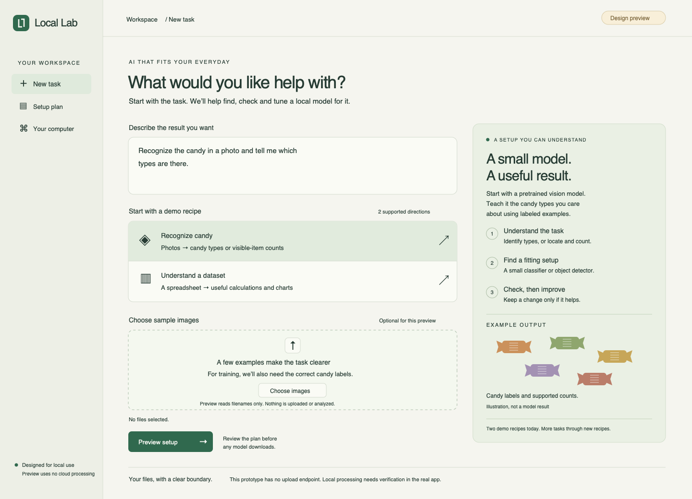

# Local Lab

**Describe an everyday task. Get a local model setup that is checked and tuned for it.**

Local Lab helps people select, install, evaluate and improve open-source local models. The Haunted Hacks demo has two recipes: **candy recognition** and **data analytics**. The platform direction is broader everyday tasks; that is not a claim that arbitrary tasks are already supported.



## Start here

1. Open this repository as a project in Codex.
2. Paste the prompt from [START_HERE.md](START_HERE.md).
3. Read [the build plan](docs/BUILD_PLAN.md) and [architecture](docs/ARCHITECTURE.md).

## Run the design preview

Node 22 or later; no package installation is needed.

```sh
npm run dev
```

Open **http://127.0.0.1:4173** manually. To use another port, set `PORT`. Stop the server with Ctrl+C. `npm run check` checks JavaScript syntax without starting a browser.

The interactive preview supports recipe switching, a task description, filename selection/validation and a proposed setup outline. It does not read file contents, upload files, call an AI model, register agents, connect a database or run training. Decorative outputs are illustrations. The server exposes only the public preview files and binds to loopback.

## What the real app should demonstrate

- A person describes their task and approves the setup/download budget.
- A planner and evaluator/optimizer perform useful work through **Agent Relay**.
- **Terse Durable Actors** retain task/trial state and coordinate one heavy model job at a time.
- The app measures a baseline and proposes a bounded improvement, preserving the baseline if tuning loses.
- The person receives a usable local task interface and a clear explanation of the tradeoff.

| Demo | Intended output | Model strategy |
| --- | --- | --- |
| Candy recognition | Candy types present; boxes/counts only when an object detector is implemented | Small pretrained classifier or detector, with approved labeled examples and held-out photos |
| Data analytics | Correct calculated metrics and useful charts from a CSV | Small local text model selects validated operations; trusted code calculates results |

An agent is a worker that makes decisions and uses tools. A model is an engine that worker can use. Downloads, renderers and arithmetic are ordinary code, not additional agents.

## Files

| File | Purpose |
| --- | --- |
| [START_HERE.md](START_HERE.md) | Copy-paste implementation prompt for Codex |
| [AGENTS.md](AGENTS.md) | Repo working rules and browser/privacy boundaries |
| [PRODUCT.md](PRODUCT.md), [DESIGN.md](DESIGN.md) | Product intent and quick visual direction |
| [docs/ARCHITECTURE.md](docs/ARCHITECTURE.md) | Repo roles, adapters, scheduling and data ownership |
| [docs/BUILD_PLAN.md](docs/BUILD_PLAN.md) | Five-hour milestones, teammate split and cut decisions |
| [docs/DATASETS.md](docs/DATASETS.md) | Sources, training targets and time-budget caveats |
| [docs/design.svg](docs/design.svg) | Static screen concept; not a screenshot or model result |
| `index.html`, `styles.css`, `app.js` | Interactive design prototype |

## Scope and honesty

The starter has **no implemented model, Terse, Relay or Supabase integration**. Build a real shared request/result path first. No universal installer, production OS sandbox or verified “best model” claim is implied. Model selection means best among configurations actually tested for a particular supported task.

Candy recognition and analytics are the current demo. Audio and image generation are future recipe directions. Weight fine-tuning is optional after a baseline works and a short measured pilot fits the budget. Prompt/settings changes must be labelled separately from learned adapters.

## Event and sharing

[Haunted Hacks](https://events.ycombinator.com/haunted-hacks-2026), October 31, 2026: hacking 11 a.m.–4 p.m. Pacific, Builderbase submission, all application code created at the event. Check permitted preparation and supported sponsor package versions with organizers.

This repository is intended to be private. Add friends through GitHub repository **Settings → Collaborators**. Never commit credentials, private datasets, downloaded weights or training artifacts. Check upstream model/data licenses before redistribution.
