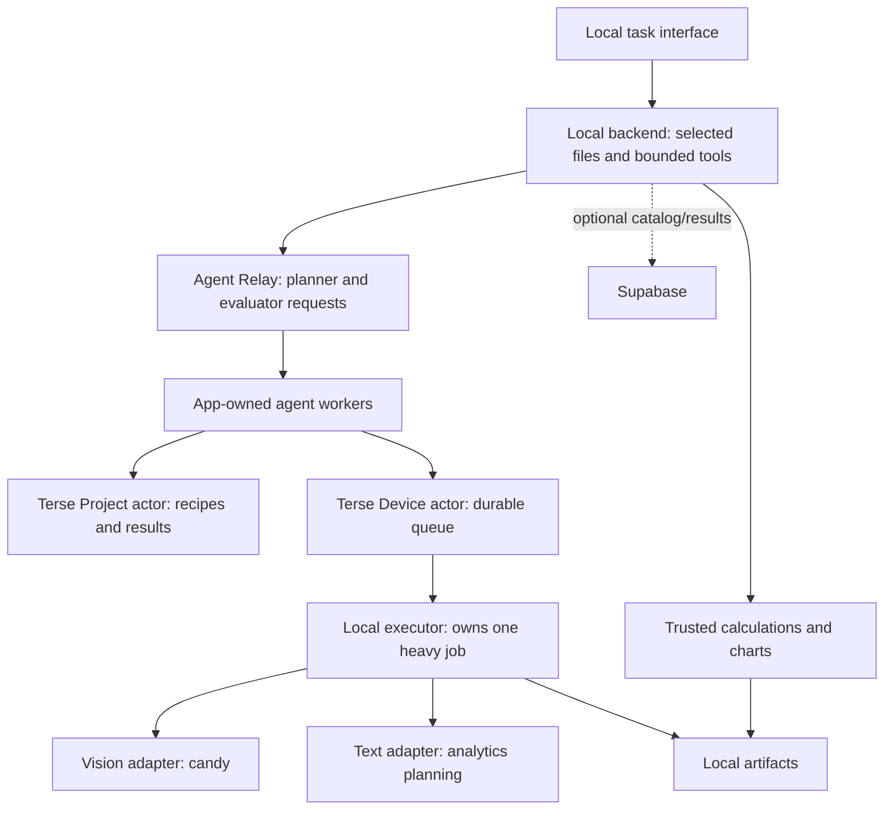

# Proposed implementation architecture

This is a plan. No sponsor/runtime/database adapters are implemented in the starter.

## Agent responsibilities

- **Planner:** understand the request, resolve output ambiguity and propose a supported recipe/configuration within hardware/time limits.
- **Evaluator/Optimizer:** select relevant development checks, interpret actual failure categories and propose at most one bounded change. Checks and metrics themselves are ordinary trusted code. Add a third worker only if it makes independent useful decisions.
- **Executor:** run approved operations and report job/attempt ID, outputs, timings and errors. It is not an additional LLM by default.

[Relay SDK](https://github.com/AgentWorkforce/relay/blob/main/packages/sdk/README.md): register/reconnect identities; receive messages/events; typed actions are asynchronous. Persist acknowledgement IDs and wait for correlated completion/failure. Schema-validated channel messages are an acceptable first integration; do not advertise typed actions until implemented.

## Actor state

| Actor | Persisted fields |
| --- | --- |
| Project | Task definition, recipe version, approvals, dataset/split references, candidate config, trial IDs, scores, selected baseline/improvement and artifact references |
| Device | Pending jobs, active job/attempt, executor boot identity, lease/cancellation state and next wake time |

[Terse quickstart](https://docs.useterse.ai/quickstart) currently uses Bun 1.4.2+, terse-cli and terse-sdk/actor. [CLI](https://docs.useterse.ai/reference/cli) and [SDK](https://docs.useterse.ai/reference/typescript-sdk) references describe local state and alarms. Confirm the event-supported versions before installation. One actor has one alarm; store all due work and arm the next deadline. A local alarm needs a running runtime/worker; it does not wake a sleeping Mac.

Persist job → reserve device → execute → save result/artifact → record completion → release. Make each transition idempotent. Actor serialization alone does not stop external workers competing for the GPU. An expired lease does not prove the old worker died. Reconcile first, fence stale attempts and avoid duplicate jobs. Recovery between jobs is the initial demo; interrupted generation does not automatically resume.

## Recipe and adapter contract

A recipe has an ID/version, task/input/output schemas, supported model/runtime identifiers, allowed tools, label/column requirements, baseline configuration, evaluation checks and time/memory/download budgets.

An adapter supports capability inspection, approved model installation, task execution and result metadata. Add evaluation/tuning only where supported. Catalog known model IDs first. Keep original data local; identify resources by validated app-owned IDs. Do not let a model generate a shell installer or choose arbitrary paths.

## Candidate engines

- **Analytics:** Ollama + a small Qwen model for planning; bounded app calculations and Vega-Lite for charts. Optional 4B/8B comparison after one model works.
- **Candy:** a small pretrained image classifier for one label, a multi-label classifier for types present, or a small detector for boxes/counts. [Ultralytics training docs](https://docs.ultralytics.com/modes/train) document Apple MPS support. Verify license, dataset class coverage and actual M5 behavior. A vision engine is separate from the Qwen text engine.
- **Later:** Whisper for audio, MFLUX for diffusion. Do not add these runtimes to today's critical path.

## Local and cloud boundary

Use local actor development and model execution for the demo. Relay may be hosted; keep private input content out of shared channels. If cloud controllers are used, operate on public/synthetic setup data and disclose it. Daily tasks can use a saved local recipe without requiring another hosted setup conversation.

Supabase may hold a shared model/recipe catalog and opt-in published aggregate results. Terse owns live execution state. Uploaded training photos, private CSVs, weights and adapters stay local. No production OS sandbox is implied by a workspace folder.
