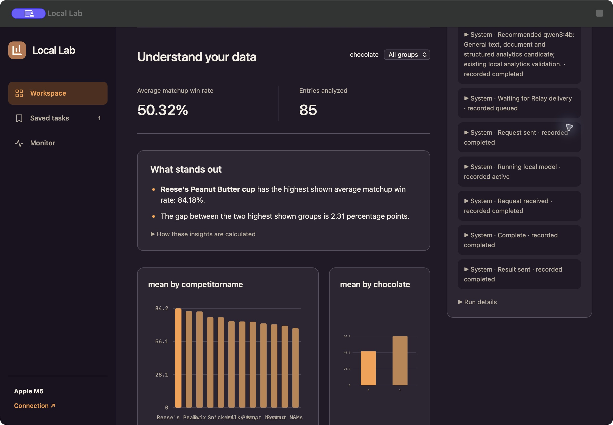

# Standalone Mac acceptance

The native candidate was exercised through its own SwiftUI/WKWebView window on an **Apple M5 MacBook Pro with 32 GB memory, macOS 26.6.2**. Application source tested: `4c77c3d964b21c81cff454c7b53371c2683e1c9d`. This is a test on the development Mac with a fresh Application Support runtime, not a test on a second physical device.

This is an unmodified capture of the native app displaying calculated public CSV results. The Activity panel retains recorded stages after completion. The dashboard is not a training-results visualization.

## What was exercised

| Requirement | Observed result |
| --- | --- |
| Native first launch | The packaged `.app` opened its own setup window; no Vercel page or Terminal window was needed. |
| Runtime installation | **Install Runtime** verified and installed the packaged source, locked dependencies and official Ollama runtime into `~/Library/Application Support/Local Lab/Runtime`. Existing compatible Node 26.5.0 was used; Bun 1.4.4 executed successfully. |
| Explicit coordination consent and retry | **Create Workspace and Start** created the app's Relay setup. The first attempt received a temporary service-overload response; the app stopped cleanly, preserved partial setup, and completed it on retry. |
| Owned startup and authentication | The app waited for its launcher readiness nonce, started its own Terse/Ollama/backend services and paired its embedded local interface automatically. |
| Native file selection | The standard Mac file picker selected a hash-verified public CSV, and the interface imported all 85 entries. |
| Hardware-based model setup | Actual recommendation on this Mac selected **Qwen3 4B**. Its approximately 2.5 GB download ran through the Device queue and completed in the app-owned model store. |
| Actual model work | One local Ollama planning call completed with **304 input tokens, 63 output tokens and 3,901 ms model time**, including 1,034 ms reported load time. These are one run's model measurements, not end-to-end setup time or a general speed claim. |
| Real Relay handoff | The planning job recorded matching request-sent/request-received IDs and matching completion-sent/completion-received IDs. The job was marked `viaRelay: true`. |
| CSV arithmetic and interactive filters | Native UI and independent CSV calculations matched the table below. DuckDB calculated the statistics from the uploaded file. |
| Saved work | The ready task reopened from **Saved tasks** with its result and recorded Activity. |
| Clean quit | The normal **Quit Local Lab** action stopped the app and its owned runtime processes, released ports 4173/11435/7100, and removed launcher/readiness session files. |
| Durable restart | Opening the app again restarted its runtime, paired automatically and recovered the same saved task and 85-entry dashboard. |
| Catalog fallback | Recommendation reported the reviewed built-in catalog, version `2026-10-31-v1`, because a shared catalog was not configured in this fresh runtime. |
| Halloween interface | The native interface's Halloween switch worked. |

## Reproducible public input

[FiveThirtyEight candy-data.csv, pinned revision](https://raw.githubusercontent.com/fivethirtyeight/data/4b9d687691091f8e44addfb051a651aebc1a4862/candy-power-ranking/candy-data.csv), **CC BY 4.0**.

SHA-256: `46c17cdb8c0212bc3e0cee2a9617a75d1ce642cd1559c332b1d9a2c4ed19b8cb`.

Prompt: “Compare candy popularity using matchup win rates. Rank candies and let me filter chocolate versus non-chocolate entries.” Measure: average of `winpercent`; group: `competitorname`; filter: `chocolate`; no date column.

| Filter | Entries | Mean winpercent |
| --- | ---: | ---: |
| All | 85 | 50.316763811764716 |
| Chocolate (`1`) | 37 | 60.9215294054054 |
| Non-chocolate (`0`) | 48 | 42.142257 |

These are historical head-to-head preference scores, not sales or causal effects. The selected model digest was `359d7dd4bcdab3d86b87d73ac27966f4dbb9f5efdfcc75d34a8764a09474fae7` (Ollama, Q4_K_M, Apache-2.0).

## Supporting checks and boundaries

Native app/helper builds and the standalone headless check executable passed, covering navigation, consent arguments, runtime inspection, repeated Quit, injected cleanup errors and real orphan-process cleanup. The launcher suite passed **18 tests**, backend **39**, frontend **28**, plus static checks and the frontend build. An independent source review found and verified fixes for installation paths containing spaces and repeated Quit bypassing cleanup.

The exact-commit package passed ZIP/checksum verification, embedded source revision/hash checks, arm64 executable checks and `codesign --verify --deep --strict`. No credentials, model weights, private inputs or dependency directories were included in its source archive.

The candidate is **ad-hoc signed and not notarized**. It is not an App Sandbox build. Runtime/model setup and Relay coordination use network services; model inference and CSV processing run locally. No new weight fine-tuning was run for this acceptance test. MLX training and broader workflows retain their separate setup and validation requirements.

## Cloud-developed acceptance runner

The published Codex Cloud environment produced the four files under [`tools/acceptance`](../tools/acceptance/README.md), originally at cloud commit `0a5b7feefad0e2afd20322a60c87b02752146a46`. Cloud could not push through its GitHub proxy, so its exact patch was exported, checksum-verified (`cdd7c6cdcdb4f105e0bd82688187f99317617befcbeb5fbd30fa6daffb756622`), reviewed and integrated locally. Seven portable unit tests passed; they are not local-model evidence.

The real runner then passed **eight API checks** against the native app's own installed runtime on November 1, 2026. It authenticated locally, verified the installed model digest and public CSV hash, created a real queued model job, checked its validated plan and positive inference measurements, compared all three dashboard/filter cases with independent CSV arithmetic, and reopened the saved task. Task: `097cfec1-06bd-4229-ad19-9a86885dfa32`. Job: `07865967-28e1-42c2-b5aa-4d4b4baf2de1`.

That run took **49.574 seconds** from runner start to report completion, including real Relay coordination; Ollama reported **5,784 ms model time, 149 output tokens and 780 ms load time**. This is one run, with the model already installed. The native window displayed the same saved result and an empty Device queue afterward. Normal Quit again removed the owned services, ports and session markers.

The first local invocation lacked sandbox loopback access and was incomplete. The next invocation's 15-second task-creation request timed out while Relay was working; its public-data job was subsequently confirmed ready. The runner now allows 60 seconds for that POST and never automatically retries it, because a lost response may still have created durable work. A fresh run passed. The API runner deliberately leaves native readiness, build provenance and full process-restart checks to the separate native acceptance above.
